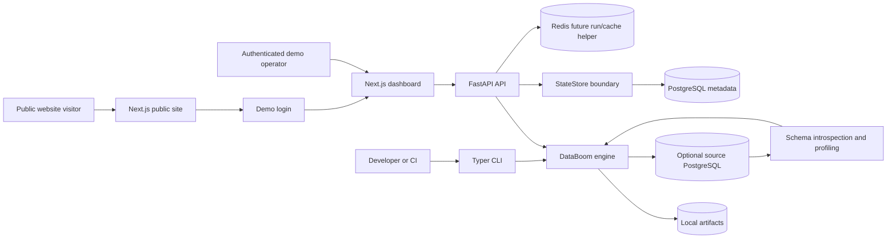
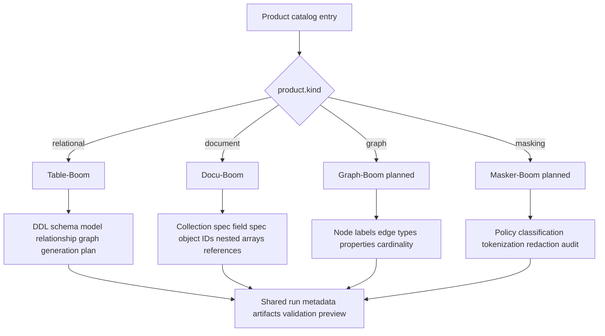
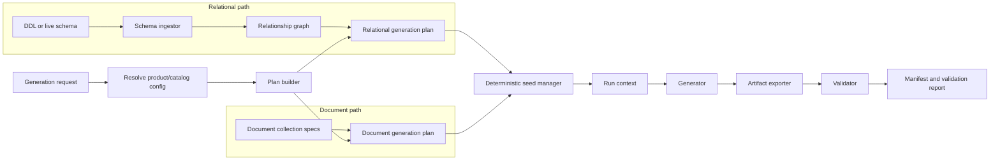
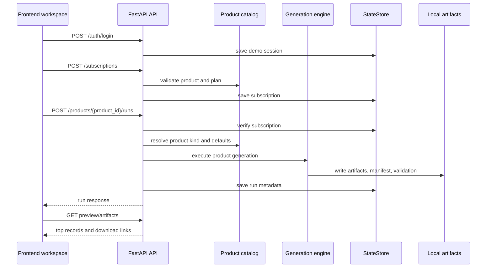
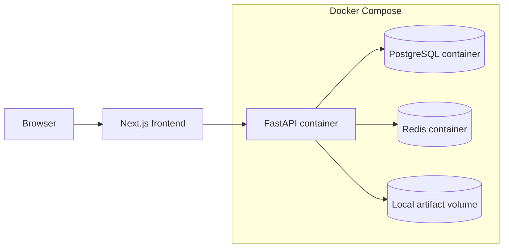

# DataBoom Architecture

DataBoom is designed as a product platform, not a single hard-coded generator. The extension point is the data surface: relational tables, document collections, graph nodes/edges, and masking policies.

## System Context



The public site explains the platform. The authenticated dashboard executes product workflows. The CLI remains the fastest local and CI path. Both API and CLI call the same backend engine boundaries wherever possible.

## Product Surface Model



Banking, healthcare, ecommerce, insurance, and SaaS are use cases. They should be represented as schemas, profiles, demo folders, prompt presets, or catalog metadata under a product. They should not become separate engines unless they introduce a new data surface.

## Engine Pipeline



The engine is extendable because each product kind owns its input model and generation strategy, while shared concerns remain reusable:

- catalog resolution,
- seed management,
- artifact root conventions,
- manifests,
- run metadata,
- validation reports,
- API artifact downloads,
- frontend preview routing.

## API Run Flow



## Frontend Route Architecture

```mermaid
flowchart TD
    Root[/ public home] --> Products[/products public product catalog]
    Root --> Demos[/demos public demo data]
    Root --> Roadmap[/roadmap public roadmap]
    Root --> Contact[/contact public contact]
    Root --> Login[/login]

    Login --> Dashboard[/dashboard authenticated workspace]
    Dashboard --> ProductDetail[/products/[productId] authenticated product run page]
    Dashboard --> Runs[/runs authenticated run history]
    Runs --> RunDetail[/runs/[runId] authenticated run output]
    Dashboard --> Settings[/settings/subscriptions authenticated settings]

    Dashboard --> DataWorkspace[DataWorkspace component]
    DataWorkspace --> RelationalSurface[Table grid for relational products]
    DataWorkspace --> DocumentSurface[JSON cards for document products]
    DataWorkspace --> PlannedSurface[Planned state for graph/masking]
```

The public pages should contain core product marketing and knowledge. The authenticated routes should contain operational workflow: subscribe, generate, preview, download, and inspect runs.

## Deployment Topology



Current local deployment uses Docker Compose for FastAPI, PostgreSQL, and Redis. Next.js runs as the local frontend during development. Phase 5 should add a production frontend container, CI, structured logging, retention controls, and deployment documentation.

## How To Add A New Product Kind

1. Add or extend the product kind enum and API response contract.
2. Add a catalog entry with defaults, output formats, status, features, and use cases.
3. Add an internal spec/model for the new data surface.
4. Add a generator service that returns the shared run response shape.
5. Add validation and artifact export logic for that surface.
6. Add preview endpoints when the data shape needs a custom preview.
7. Add a frontend surface component selected by `product.kind`.
8. Add focused tests for catalog, generation, preview, artifact, and planned-state behavior.

This sequence keeps the platform extendable without scattering product-name conditionals across routes or UI pages.
