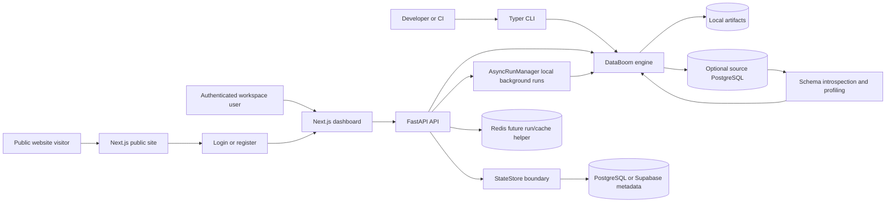
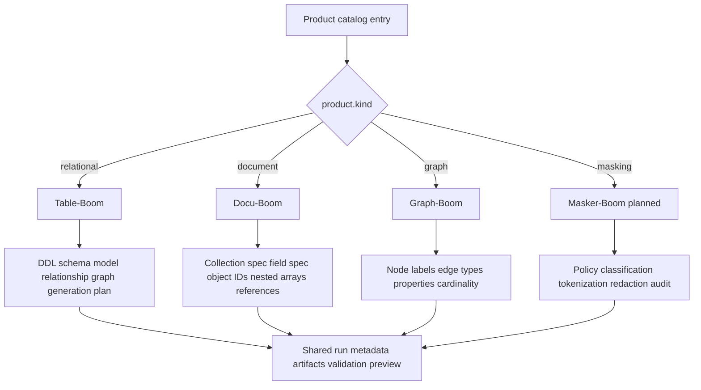
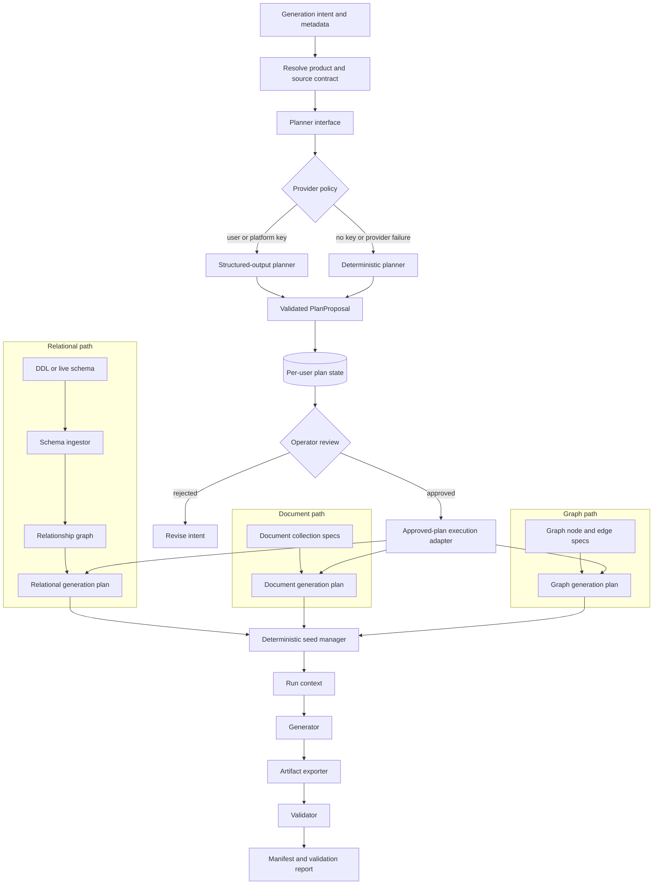
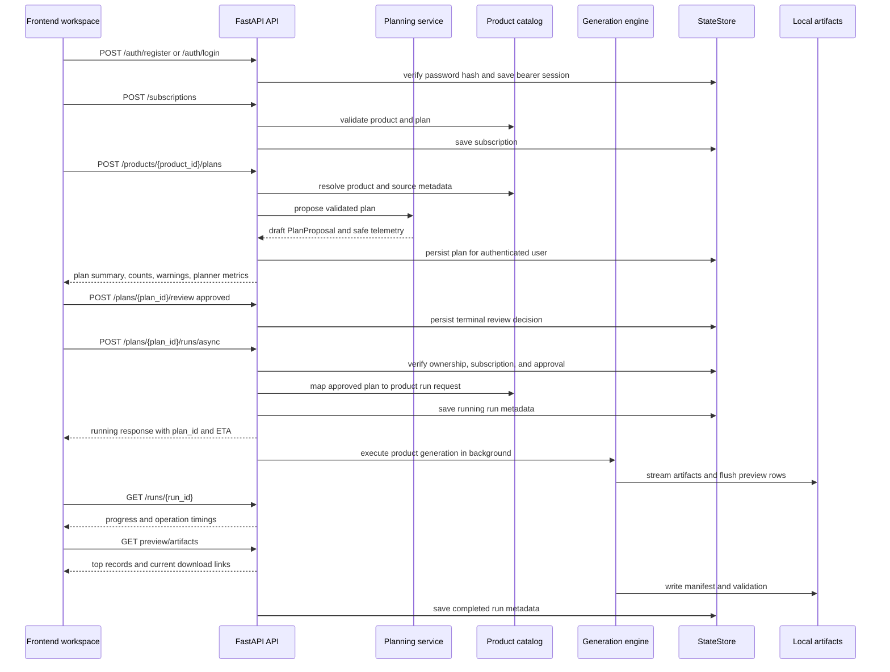
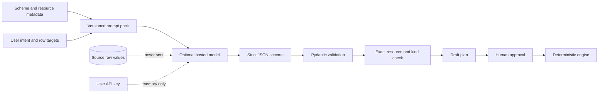
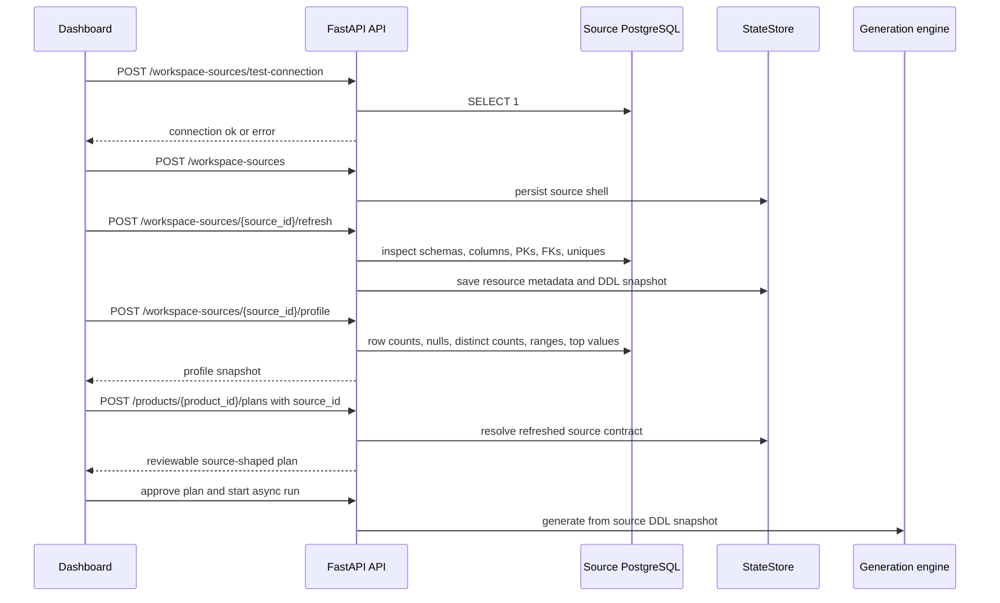
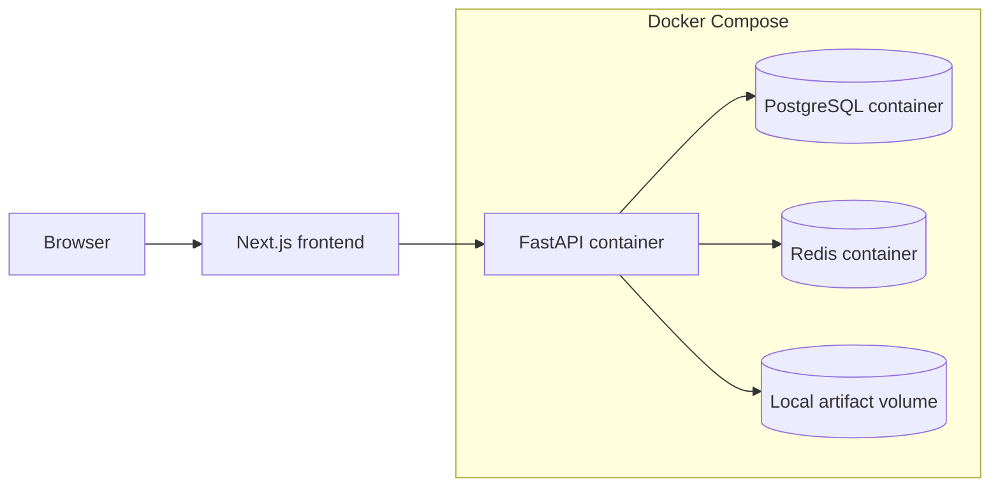
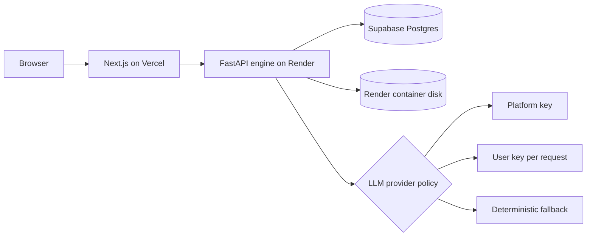

# High-Level Design

DataBoom is designed as a product platform, not a single hard-coded generator. The extension point is the data surface: relational tables, document collections, graph nodes/edges, and masking policies.

This document is the canonical system architecture for DataBoom. It describes
services and trust boundaries, not individual Python methods. For module-level
ownership, runtime state, and artifact processing, see [Low-Level Design](low-level-design.md).

## System Context



The public site explains the platform. The authenticated dashboard executes product workflows. The CLI remains the fastest local and CI path. Both API and CLI call the same backend engine boundaries wherever possible.

## Product Surface Model



Banking, healthcare, ecommerce, insurance, and SaaS are use cases. They should be represented as schemas, profiles, demo folders, prompt presets, or catalog metadata under a product. They should not become separate engines unless they introduce a new data surface.

## Engine Pipeline



The planner controls only a small, validated decision: resource names, target
counts, strategies, constraints, warnings, seed, and formats. It does not emit
bulk records and cannot execute a run. Generation remains deterministic and
product-specific after approval, so provider availability and model behavior do
not become data-integrity dependencies.

The engine is extendable because each product kind owns its input model and generation strategy, while shared concerns remain reusable:

- catalog resolution,
- seed management,
- artifact root conventions,
- manifests,
- run metadata,
- validation reports,
- API artifact downloads,
- frontend preview routing.

## API Run Flow



### Planning Trust Boundary



Stable instructions, output schema, and examples are loaded from a versioned
package prompt pack. Variable source metadata and intent come last. The schema
fingerprint and prompt-pack version form a non-sensitive cache key. Telemetry
records token counts, cached tokens, latency, mode, and fallback reason without
recording prompts, keys, or source values.

## Workspace Source Flow



This makes the engine extendable because the dashboard does not send ad hoc table lists. It selects a persisted source, and the backend uses the refreshed schema contract for planning and generation.

## Frontend Route Architecture

```mermaid
flowchart TD
    Root[/ public home] --> Products[/products public product catalog]
    Root --> Demos[/demos public demo data]
    Root --> Roadmap[/roadmap public roadmap]
    Root --> Contact[/contact public contact]
    Root --> Login[/login]

    Login --> Dashboard[/dashboard authenticated workspace]
    Dashboard --> ProductDetail[/products/[productId] authenticated product run page]
    Dashboard --> Runs[/runs authenticated run history]
    Runs --> RunDetail[/runs/[runId] authenticated run output]
    Dashboard --> Settings[/settings authenticated settings]
    Settings --> Subscriptions[/settings/subscriptions product access]

    Dashboard --> DataWorkspace[DataWorkspace component]
    DataWorkspace --> RelationalSurface[Table grid for relational products]
    DataWorkspace --> DocumentSurface[JSON cards for document products]
    DataWorkspace --> GraphSurface[Node and edge preview]
    DataWorkspace --> PlanReview[Plan proposal and approval]
    DataWorkspace --> PlannedSurface[Planned state for masking]
```

The public pages should contain core product marketing and knowledge. The authenticated routes should contain operational workflow: subscribe, generate, preview, download, and inspect runs.

## Deployment Topology

### Local Docker



Local deployment uses Docker Compose for FastAPI, PostgreSQL, and Redis. Next.js runs as the local frontend during development.

### Render, Supabase, And Vercel



Render runs the Python API and generation engine. Supabase stores users,
sessions, subscriptions, sources, profiles, plans, and run metadata through the
existing `StateStore` boundary. Vercel hosts the public site and dashboard. The
LLM policy is optional: user key first, platform key second, deterministic
fallback always available.

For exact environment variables and smoke tests, see [Deployment Guide](../operations/deployment.md).

## Run Observability

The API exposes a lightweight asynchronous run lifecycle:

- `POST /products/{product_id}/plans` creates a reviewable proposal.
- `POST /plans/{plan_id}/runs/async` creates a run only after approval.
- `GET /runs/{run_id}` returns status, generated rows, current resource, progress percentage, rows per second, expected seconds, remaining seconds, and operation timings.
- Table previews read flushed CSV rows while generation is still running.
- Document previews read completed JSON arrays or partially flushed NDJSON lines.
- Graph previews read generated graph JSON or node/edge CSV files after a graph run.
- Completed relational runs report timings for schema parsing, plan building, export, validation, and total runtime.

The current `AsyncRunManager` is intentionally in-process. It is enough for local MVP workflows, demos, and frontend progress polling. A production worker queue can replace this boundary later without changing the frontend run contract.

## Source Observability

Phase 2 source workflows expose separate operations so the dashboard can show where time and risk sit:

- connection test checks that credentials and network access work before a source is saved or refreshed,
- schema refresh captures table names, schema names, columns, primary keys, foreign keys, unique constraints, a DDL snapshot, and a refresh timestamp,
- source profiling scans selected tables for row counts, null rates, distinct counts, min/max values, and top values,
- product runs can reference a `source_id`, allowing the engine to generate from the refreshed source contract.

These operations are separate on purpose. A quick schema refresh should not always scan table data, and a profiling scan should be an explicit operator action.

## How To Add A New Product Kind

1. Add or extend the product kind enum and API response contract.
2. Add a catalog entry with defaults, output formats, status, features, and use cases.
3. Add an internal spec/model for the new data surface.
4. Add a generator service that returns the shared run response shape.
5. Add validation and artifact export logic for that surface.
6. Add preview endpoints when the data shape needs a custom preview, such as document or graph runs.
7. Add a frontend surface component selected by `product.kind`.
8. Add focused tests for catalog, generation, preview, artifact, and planned-state behavior.

This sequence keeps the platform extendable without scattering product-name conditionals across routes or UI pages.
