# Low-Level Design

This document explains how the DataBoom backend processes a request from input to generated output. It is intentionally implementation-oriented: use it when you want to understand which Python module owns which decision, how data moves, and where to extend the engine.

## Backend Package Map

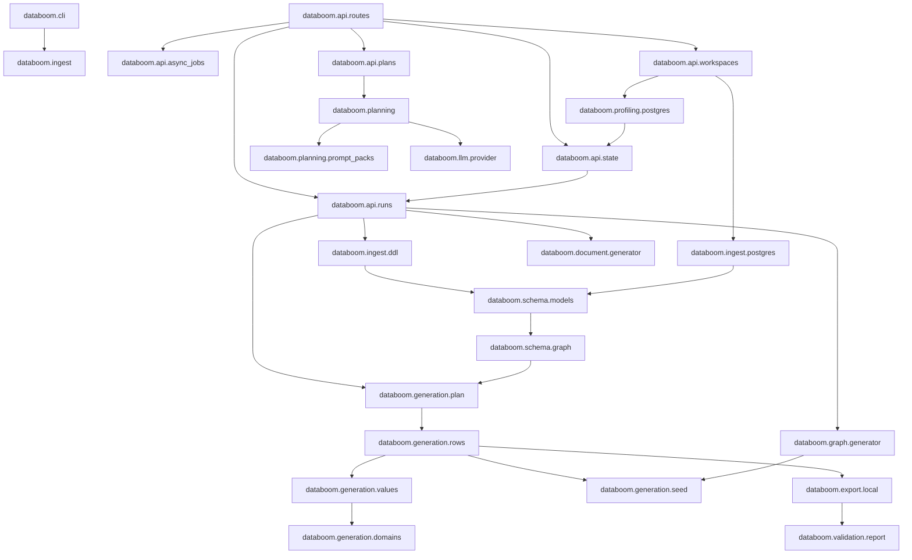

## Core Contracts

| Contract | Module | Purpose |
| --- | --- | --- |
| `DatabaseSchema` | `databoom.schema.models` | Normalized database shape after DDL parsing or live introspection. |
| `RelationshipGraph` | `databoom.schema.graph` | Parent-child dependency ordering for relational generation. |
| `GenerationPlan` | `databoom.generation.plan` | Immutable execution plan for a relational run. |
| `ColumnProfileHint` | `databoom.generation.plan` | Source-profile statistics attached to individual generated columns. |
| `RowGenerator` | `databoom.generation.rows` | Streams rows table by table while preserving key relationships. |
| `ValueGenerator` | `databoom.generation.values` | Generates scalar values from type, profile, domain, and seed rules. |
| `ExportManifest` | `databoom.export.local` | Lists generated artifact paths and row counts. |
| `ValidationReport` | `databoom.validation.report` | Machine-readable integrity and artifact validation result. |
| `DocumentCollectionSpec` | `databoom.document.models` | Declarative Docu-Boom collection and field definition. |
| `GraphNodeSpec` / `GraphEdgeSpec` | `databoom.graph.models` | Declarative Graph-Boom node labels, edge types, endpoint labels, and properties. |
| `GraphGenerator` | `databoom.graph.generator` | Streams graph JSON and CSV artifacts while preserving valid edge endpoints. |
| `PlannerRequest` | `databoom.planning.models` | Provider-neutral metadata and intent accepted by every planner. |
| `PlanDecision` | `databoom.planning.models` | Strict small output containing resources, strategies, constraints, and warnings. |
| `PlanProposal` | `databoom.planning.models` | Persisted draft/approved/rejected plan with safe telemetry and content-addressed identity. |
| `Planner` | `databoom.planning.planner` | Replaceable interface implemented by deterministic and structured-output planners. |
| `SourceProfile` | `databoom.profiling.postgres` | Cached source statistics used to shape future generation. |
| `StateStore` | `databoom.api.state` | Persistence boundary for sessions, subscriptions, sources, profiles, plans, and runs. |

## Planning And Review Execution

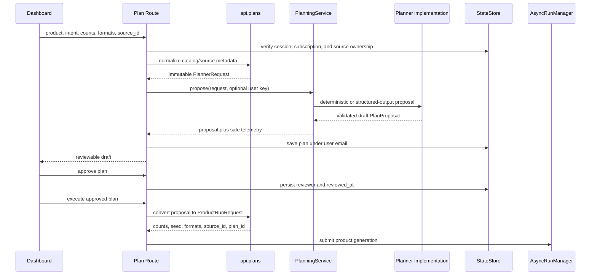

`planner_request_from_product` is the boundary that prevents source rows from
entering model input. It maps catalog or refreshed source metadata to resource
contracts. `proposal_from_decision` then requires the planner to return exactly
the same resource names and kinds. The engine receives only an approved proposal
translated into its existing `ProductRunRequest`.

### Prompt Pack And Cache Flow

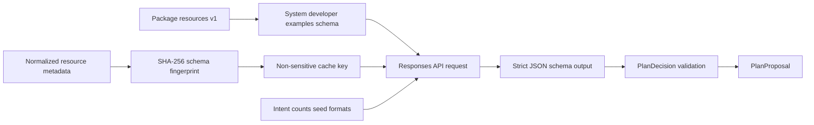

Prompt files are package resources rather than relative filesystem reads, so a
wheel, local process, and Docker image load the same version. Stable content is
placed before variable request data. The cache key contains product kind,
planner version, schema fingerprint, and prompt-pack version; it contains no user
identity, connection secret, or row value.

## Table-Boom Execution

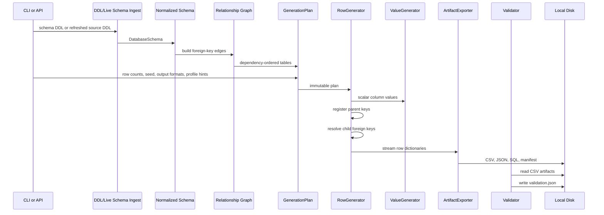

### Table-Boom Step Details

1. Input arrives through CLI or API.
2. DDL is parsed by `databoom.ingest.ddl`, or live PostgreSQL metadata is read by `databoom.ingest.postgres`.
3. Both input paths produce the same `DatabaseSchema` contract.
4. `databoom.schema.graph` builds parent-child edges from foreign keys.
5. `databoom.generation.plan.create_generation_plan` converts schema into an immutable `GenerationPlan`.
6. `RowGenerator.from_plan` creates run-local mutable state: seed manager, value generator, and foreign-key registry.
7. Tables stream in dependency order so parent keys exist before child rows need them.
8. `ArtifactExporter` writes output files row by row instead of holding the full dataset in memory.
9. `validate_export` re-reads exported CSV files and verifies row counts, required values, primary keys, foreign keys, and fanout metrics.

## Profile-Driven Value Flow

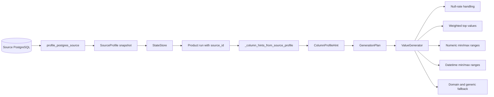

Profile evidence wins over generic fallback behavior because observed source shape is stronger than broad domain assumptions. The fallback path still exists so a missing, stale, or incomplete profile does not block a run.

### Value Resolution Order

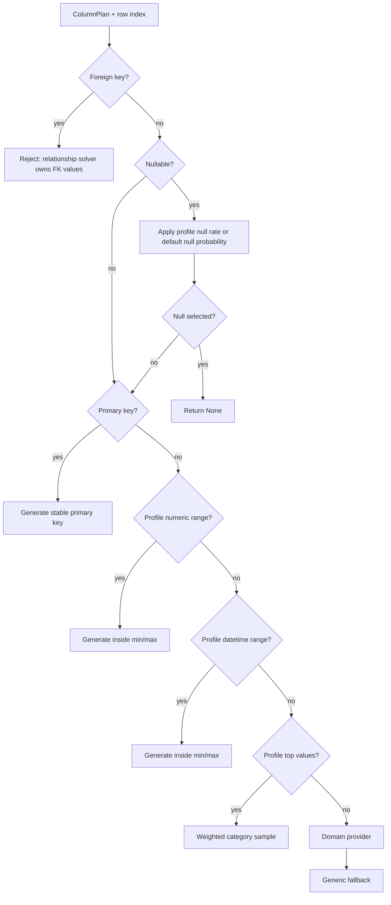

## Relationship Solving

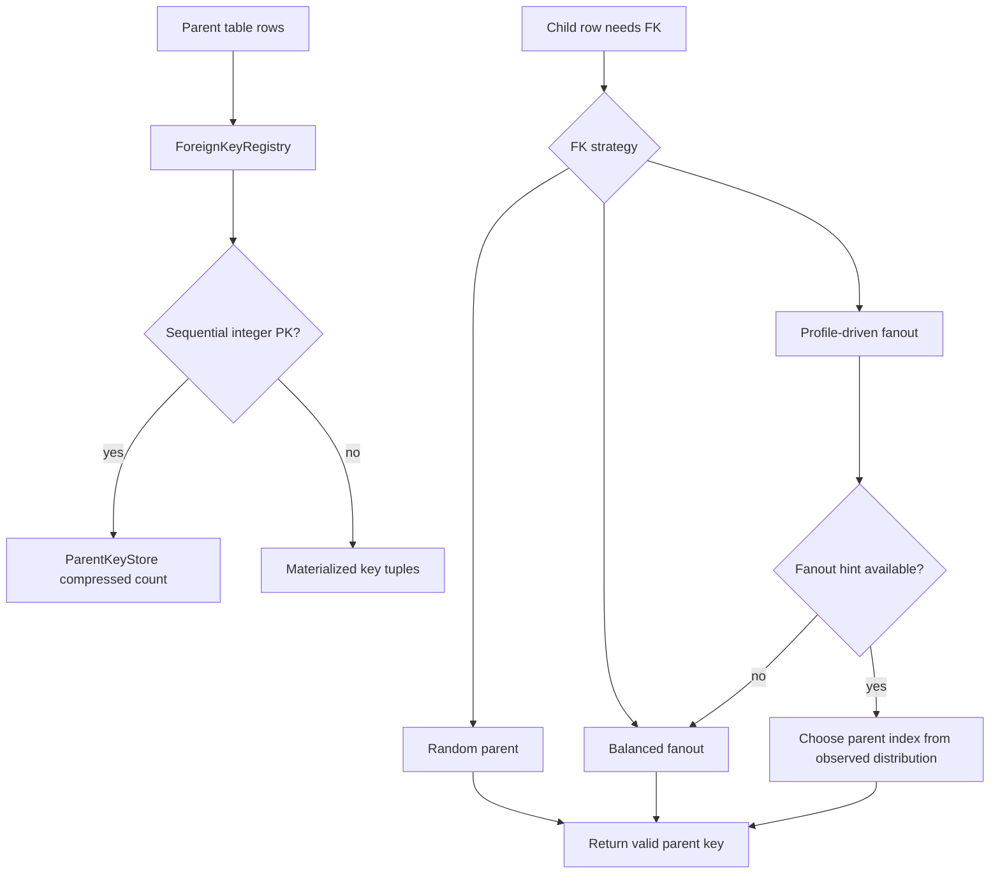

The compressed parent-key path is important for scale. A common table with `id = 1..N` does not require storing one million one-item tuples. The store materializes only when the key shape stops being a simple sequential integer.

## Docu-Boom Execution

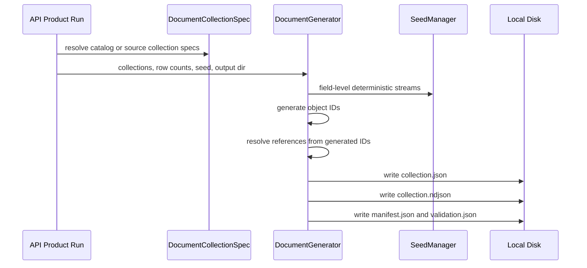

Docu-Boom is separate from Table-Boom because document data has nested objects, arrays, and object-id references. It should not inherit table-specific assumptions like SQL primary keys or foreign-key constraints.

## Graph-Boom Execution

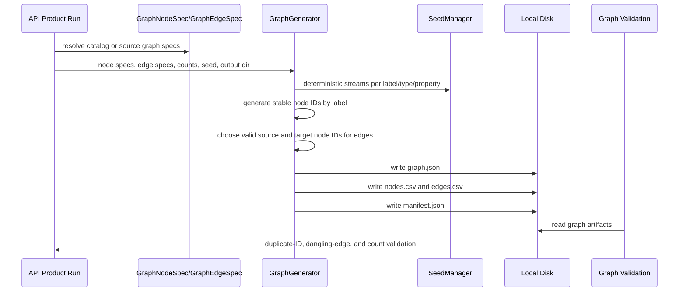

Graph-Boom is separate from Table-Boom because graph correctness is endpoint
validity, label/type consistency, and edge cardinality. It reuses seeds,
artifact directories, API run metadata, async progress, and artifact downloads,
but owns its own node/edge contracts and validation.

## API Async Run Flow

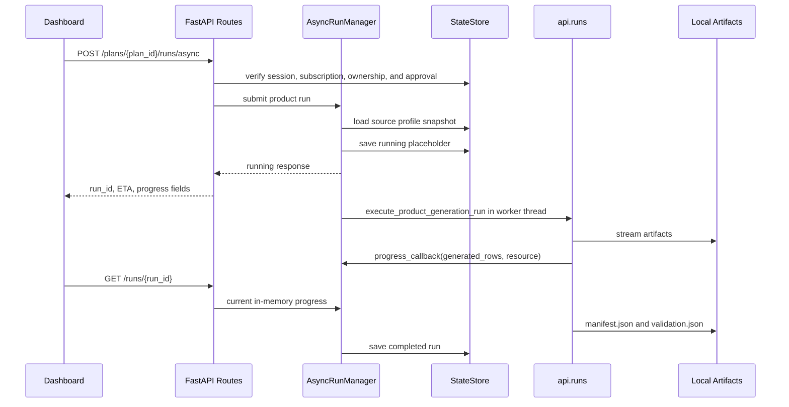

The async manager is in-process by design for the local MVP. It gives useful progress and cancellation behavior without introducing a queue too early. A future worker queue can replace `AsyncRunManager` behind the same route contract.

## State And Artifact Ownership

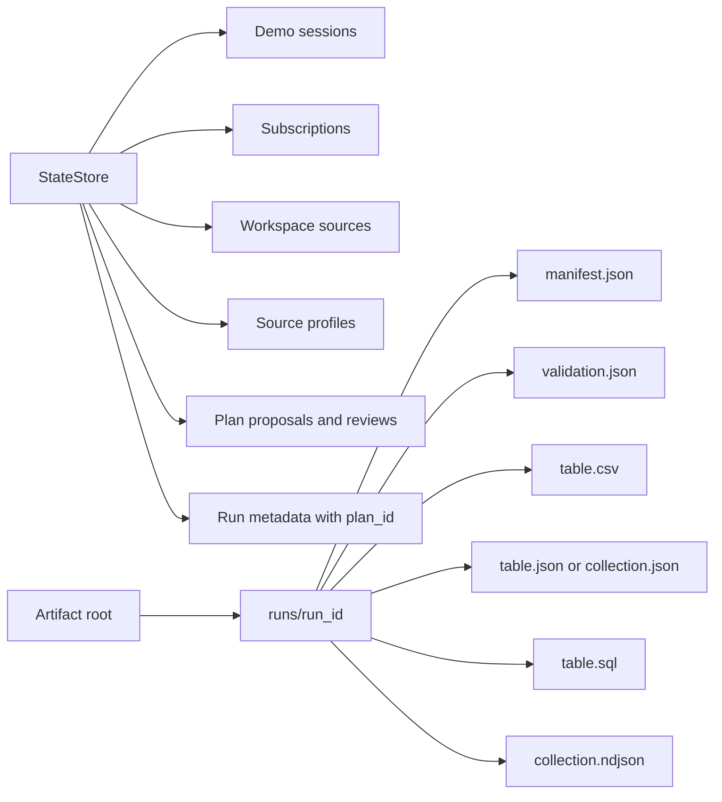

State and artifacts are intentionally separate:

- StateStore stores metadata needed to list and resume dashboard context.
- Local disk stores generated data artifacts.
- API artifact routes resolve paths from run metadata and manifests.
- Validation reads artifact files so it catches exporter or partial-write issues.

## File Output Rules

| Output | Writer | Current Use |
| --- | --- | --- |
| CSV | `_CsvTableWriter` | Main relational validation and table preview format. |
| JSON | `_JsonTableWriter`, document writer, and graph writer | Relational JSON exports, document collection arrays, and graph JSON. |
| SQL | `_SqlTableWriter` | Portable local replay inserts. |
| NDJSON | `DocumentGenerator` | Streaming-friendly document preview/export format. |
| Graph CSV | `GraphGenerator` | Node and edge CSV files for graph import and preview fallback. |
| Manifest | `ArtifactExporter`, `DocumentGenerator`, and `GraphGenerator` | Artifact discovery by API/frontend/CLI. |
| Validation | `validate_export`, document summary, and graph validation | Integrity status and machine-readable issues. |

## Error Boundaries

| Boundary | Failure Example | Behavior |
| --- | --- | --- |
| DDL ingestion | No `CREATE TABLE` statements | Raise `ValueError` before planning. |
| Relationship graph | Cross-table cycle | Raise `SchemaCycleError` before generation. |
| Row generation | Child table has no parent keys | Raise `RowGenerationError`. |
| Source connection | Bad PostgreSQL URL or credentials | API returns `400` with connection error. |
| Source profile | SQL profiling query fails | API returns `400`; existing cached profile remains untouched. |
| Artifact validation | Missing CSV or bad FK | `ValidationReport.passed = false` with issue codes. |
| Async cancellation | User cancels running run | Cooperative cancellation updates run state to `canceled`. |
| Planner provider | Missing key, timeout, quota, or network error | Return a deterministic proposal with a safe fallback reason. |
| Planner output | Invalid JSON, unknown resource, changed kind, or bad count | Reject provider output before persistence or execution. |
| Plan review | Draft not approved or owned by another user | Reject execution with an authorization or review-state error. |

## Extension Points

### Add A New Relational Source

1. Implement a source introspector that produces `DatabaseSchema`.
2. Implement a profiler that can produce `SourceProfile` or equivalent hints.
3. Convert profile output into `RelationshipFanoutHint` and `ColumnProfileHint`.
4. Reuse `create_generation_plan`, `RowGenerator`, `ArtifactExporter`, and `validate_export`.

### Add A New Value Behavior

1. Add the required profile field or plan hint.
2. Attach the hint in `databoom.generation.plan`.
3. Consume it in `ValueGenerator` before broad domain fallbacks.
4. Add unit tests for `ValueGenerator`.
5. Add integration tests proving planner-to-row-generation flow.

### Extend Graph-Boom

Graph-Boom introduces graph-specific contracts instead of forcing graphs through table plans:

- node specs,
- edge specs,
- label/property models,
- cardinality/fanout rules,
- graph-specific artifact writers,
- graph-specific validation.

Shared reusable pieces include seed management, state storage, API run metadata,
artifact-root conventions, artifact downloads, and progress reporting. Next graph
extensions should add richer endpoint rules, graph-source profiling, Cypher or
database-specific exports, and frontend graph visualization.

### Add Masker-Boom

Masker-Boom should be a transformation pipeline, not a generator-only pipeline:

- source reader,
- classifier,
- masking policy,
- deterministic tokenization or replacement,
- audit report,
- export writer.

It can reuse workspace sources, state storage, artifact roots, async run metadata, and validation-report patterns.

## Why This Design Is Production-Oriented

- Engine contracts are immutable where possible, so planning and execution are reproducible.
- Source profiling is a snapshot, so generation does not depend on live production data during export.
- Rows stream to disk, so large runs do not require holding the whole dataset in memory.
- Validation checks files on disk, so artifact-level problems are visible.
- Async execution is behind a manager boundary, so a worker queue can replace it later.
- Product kind selects the engine path, so product names do not leak into core algorithms.
- Profile hints are source-agnostic, so future sources can improve output without rewriting generators.
