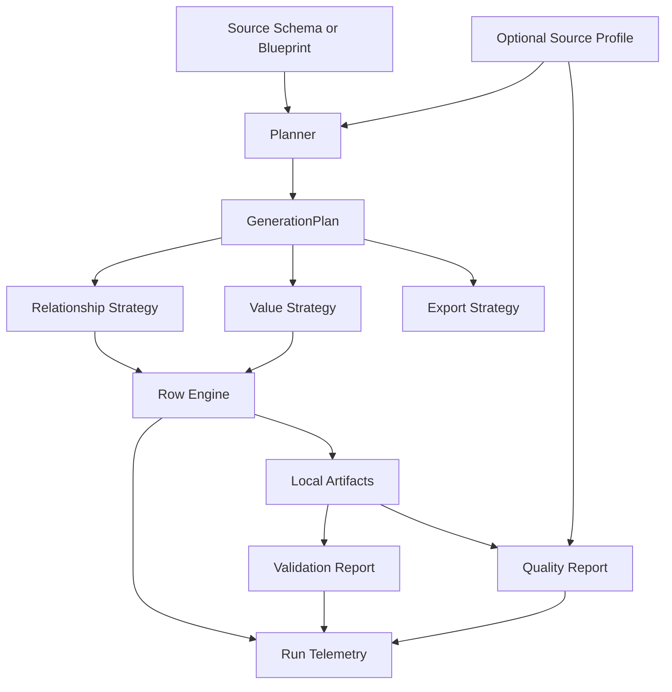

# DataBoom Optimization Plan

This document is planning only. It defines the optimization roadmap before implementation work begins.

The goal is to make DataBoom faster, more modular, more measurable, and more realistic at large-scale synthetic data generation. The plan focuses on backend engine architecture first, then source profiling, blueprints, quality reports, and runtime observability.

## Optimization Principles

- Keep product surfaces separate: relational, document, graph, and masking must not share hidden assumptions.
- Make generation behavior explicit through strategy/config objects instead of hardcoded branches.
- Treat keys and relationships as structural constraints, not ordinary random values.
- Use source profiles to improve generated distributions, but keep deterministic fallbacks when profiles are missing.
- Measure performance with repeatable benchmarks before claiming speed improvements.
- Keep long-running work observable through progress, stage timings, and artifacts.
- Avoid heavy orchestration until local async execution shows a real bottleneck.

## Architecture Targets

The optimized engine should make each major behavior replaceable:

- relationship selection,
- value generation,
- profile hint usage,
- artifact export,
- validation,
- quality comparison,
- run telemetry.

## Track A: Relational Engine Speed And Relationship Quality

Objective: make Table-Boom fast and structurally reliable at 1M+ rows.

Todo:

- [x] Add `RelationshipStrategy` or `ForeignKeySelectionStrategy` to the generation plan.
- [x] Implement balanced fanout as the default relationship strategy.
- [x] Keep random fanout as an explicit strategy for simulation-style runs.
- [x] Add validation metrics for parent-child fanout distribution.
- [x] Expose relationship cardinality from source profiling.
- [x] Persist relationship profile hints from source profiling.
- [x] Add profile-driven fanout that preserves observed child-count distributions.
- [x] Optimize parent-key storage for simple sequential primary keys.
- [x] Add benchmark: 1M records across five related tables.
- [ ] Add benchmark: 1M records with composite keys.

Recommended commit sequence:

1. `backend: add relationship selection strategy`
2. `backend: report relationship fanout metrics`
3. `backend: profile source relationship cardinality`
4. `performance: optimize parent key registry`
5. `performance: add one million row relational benchmark`

## Track B: Profile-Driven Value Generation

Objective: move from realistic-looking values to source-shaped values.

Todo:

- [x] Persist source profile snapshots with freshness timestamps.
- [ ] Add `ColumnProfileHint` model for null rate, distinct count, min/max, top values, and sample count.
- [ ] Add categorical weighted sampling from top values.
- [ ] Add numeric range and distribution-aware sampling.
- [ ] Add datetime range and seasonality hints.
- [ ] Add string pattern hints for emails, phone numbers, codes, and IDs.
- [ ] Keep deterministic fallback providers when no profile exists.
- [ ] Add tests comparing generated output against profile hints.

Recommended commit sequence:

1. `backend: persist source profile snapshots`
2. `backend: add column profile hints`
3. `backend: generate categorical values from profile hints`
4. `backend: generate numeric values from profile ranges`
5. `backend: add profile fidelity validation`

## Track C: Blueprint System

Objective: make use cases repeatable and configurable instead of hardcoded.

Todo:

- [ ] Create `blueprints/` folder.
- [ ] Define `databoom.blueprint.yaml` schema.
- [ ] Add banking relational blueprint.
- [ ] Add healthcare relational blueprint.
- [ ] Add ecommerce relational blueprint.
- [ ] Add document blueprint for Docu-Boom.
- [ ] Add blueprint loader in backend.
- [ ] Add CLI command: `databoom blueprint run`.
- [ ] Add API endpoint for blueprint listing.
- [ ] Use blueprint metadata on frontend demo/product pages.

Recommended commit sequence:

1. `backend: define blueprint schema`
2. `backend: add blueprint loader`
3. `docs: add banking and healthcare blueprints`
4. `cli: run generation from blueprint`
5. `frontend: render demos from blueprint metadata`

## Track D: Export And Runtime Performance

Objective: reduce latency and memory while generating large artifacts.

Todo:

- [ ] Add benchmark harness that records parse, plan, generate, export, validate, and total time.
- [ ] Add configurable chunk size to generation/export.
- [ ] Add batch row generation API.
- [ ] Evaluate row-oriented vs column-oriented buffers.
- [ ] Optimize CSV writer flush policy.
- [ ] Add NDJSON writer for relational rows if useful for streaming.
- [ ] Add Parquet export only after CSV/JSON/SQL path is stable.
- [ ] Add direct PostgreSQL load using `COPY` as a later optional export path.
- [ ] Add memory tracking to benchmark output.

Recommended commit sequence:

1. `performance: add benchmark telemetry contract`
2. `performance: batch relational row generation`
3. `performance: tune csv writer buffering`
4. `export: add parquet artifact writer`
5. `export: add postgres copy loader`

## Track E: Quality Reports And Evaluation

Objective: give DataBoom a credible answer to "how good is this output?"

Todo:

- [ ] Add `QualityReport` model separate from `ValidationReport`.
- [ ] Compare generated null rates to source profile null rates.
- [ ] Compare categorical distributions to profile top values.
- [ ] Compare numeric ranges to profile min/max.
- [ ] Compare relationship fanout against observed profile.
- [ ] Add score bands but avoid pretending one score proves quality.
- [ ] Surface quality report in API artifacts.
- [ ] Surface quality report summary in frontend.

Recommended commit sequence:

1. `quality: add quality report model`
2. `quality: compare generated data to source profile`
3. `quality: score relationship fanout`
4. `api: expose quality report artifacts`
5. `frontend: show quality report summary`

## Track F: Async Orchestration And Observability

Objective: make long runs reliable and inspectable.

Todo:

- [ ] Add structured run events.
- [ ] Add cancellation endpoint.
- [ ] Add resumable run design for local artifacts.
- [ ] Persist per-stage timings.
- [ ] Add source profile and blueprint IDs to run metadata.
- [ ] Keep in-process async manager for local MVP.
- [ ] Move to a worker queue only when retries and multi-worker scheduling are required.
- [ ] Keep event streaming out until there is a real product need.

Recommended commit sequence:

1. `backend: add structured run events`
2. `api: add run cancellation`
3. `backend: persist run stage timings`
4. `backend: attach blueprint and source profile metadata to runs`
5. `infra: add worker queue when local manager becomes limiting`

## Priority Plan

### First Implementation Batch

Focus only on backend engine quality and measurable performance.

1. Add relationship strategy to `GenerationPlan`. `complete`
2. Implement balanced fanout. `complete`
3. Add fanout validation/quality metrics. `complete`
4. Add 1M relational benchmark. `complete`
5. Update `understanding.md` with why the strategy improves quality and performance.

### Second Implementation Batch

Focus on profile-driven generation.

1. Persist source profile snapshots. `complete`
2. Add profile hint models.
3. Use top values, null rates, and ranges during value generation.
4. Add quality report comparing source profile vs generated output.

### Third Implementation Batch

Focus on repeatability and productization.

1. Add blueprint schema.
2. Add blueprint loader.
3. Move banking, healthcare, and ecommerce demos to blueprints.
4. Wire API and frontend demo catalog to blueprint metadata.

## What We Should Not Do Yet

- Do not add deep-learning dependencies yet.
- Do not build a model-training path before deterministic and profile-driven generation are strong.
- Do not claim statistical synthesis quality until profile-based fidelity reports exist.
- Do not add distributed workers before local async runs show a real bottleneck.
- Do not mix Masker-Boom privacy claims into Table-Boom or Docu-Boom performance work.

## Definition Of Done

The optimization program is successful when:

- DataBoom generates 1M+ relational rows with valid relationships and documented timing.
- It generates output from refreshed source metadata rather than static demo schemas.
- It uses source profiles to influence values and relationships.
- It reports quality metrics against the source profile.
- It supports repeatable blueprints for major use cases.
- It keeps memory bounded during large local runs.
- Every major engine behavior is controlled through explicit strategy/config objects instead of hidden conditionals.
