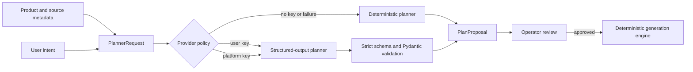

# LLM Planning, Prompt Caching, And Agent Instructions

This document owns DataBoom's LLM planning contract, prompt-pack layout, cache
strategy, telemetry, and repository instruction hygiene. The generation engines
remain deterministic; the model proposes a small plan that must pass validation
and human review.

## Runtime Boundary



The provider receives normalized metadata, resource names, field names, counts,
formats, seed, and user intent. It does not receive source rows, database
credentials, API state, user identity, or artifact contents.

## Implemented Prompt Pack

The versioned generation pack lives at:

```text
src/databoom/planning/prompt_packs/v1/
  system.md
  developer.md
  examples.md
  output-schema.json
  version.txt
```

`databoom.planning.prompts.load_prompt_pack` reads these files as Python package
resources. This is important because local source checkouts, wheels, tests, and
Docker images must use the same prompt version without relying on the current
working directory.

The stable request order is:

1. system role and safety boundary,
2. developer planning rules,
3. stable examples,
4. strict output JSON Schema,
5. variable normalized resource metadata and user intent.

Exact reusable content comes first because prompt caching depends on exact prefix
matches. Variable timestamps, run IDs, user data, sampled values, and debug text
must never be inserted before the stable blocks. Eligible requests generally need
at least 1,024 prompt tokens before cached-input accounting becomes useful.

## Strict Output Contract

The hosted adapter uses the Responses API with `text.format.type=json_schema` and
strict mode. Provider output is then validated again as `PlanDecision`.

The decision may contain only:

- a summary,
- the exact requested resources,
- a target count and strategy for each resource,
- constraints,
- warnings.

`proposal_from_decision` rejects missing resources, unknown resources, duplicate
resources, changed resource kinds, invalid counts, or extra fields. A model cannot
add a new table, collection, node, or edge that the engine did not expose.

## Prompt Cache Key

DataBoom derives a stable, non-sensitive key:

```text
databoom:{product_kind}:{planner_version}:{schema_fingerprint}:{prompt_pack_version}
```

The schema fingerprint is a SHA-256 hash of normalized resource metadata sorted
by kind and name. The key intentionally excludes:

- raw row values,
- connection strings,
- API keys,
- user email or organization,
- prompt text,
- timestamps and run IDs.

Changing a resource contract or prompt-pack version changes the key. Changing
only user intent preserves the stable namespace and reusable prompt prefix.

## Telemetry

Every `PlanProposal` records safe planner telemetry:

- planner mode and model,
- planner and prompt-pack versions,
- schema fingerprint and cache key,
- input and output tokens,
- cached input tokens,
- cache-write tokens when returned,
- planning latency in milliseconds,
- deterministic fallback reason.

Telemetry is useful for cost, latency, and cache analysis. Logs must not include
the API key, full prompt, source rows, or generated artifacts. The dashboard may
show a compact cache/latency summary, while aggregate operations dashboards are a
later observability task.

## Provider Reliability

`PlanningService` resolves providers in this order:

1. user key supplied for the current planning request,
2. platform key configured on the backend,
3. deterministic planner.

Hosted requests use bounded output tokens, timeout, and retry settings. Missing
credentials, exhausted credit, rate limits, network failures, invalid JSON, and
schema-validation failures return a deterministic proposal rather than disabling
generation. The fallback reason is safe operational metadata, not a raw provider
exception.

## User Key Handling

The frontend keeps a user-supplied key in `sessionStorage`, so it survives route
changes in one browser tab but is removed when the tab session ends. The key is
sent only while creating a plan. It is not stored in `StateStore`, `PlanProposal`,
run metadata, local storage, or backend logs.

Persistent BYOK would require encrypted secret storage, rotation, deletion,
access controls, audit events, and redaction. That is intentionally outside the
current implementation.

## Golden Contracts

`tests/fixtures/planner_golden_cases.json` defines stable relational, document,
and graph planning cases. Tests verify summaries, resource counts, strategies,
constraints, and content-addressed plan identity. Provider-adapter tests verify
strict schema mode, cache-key forwarding, telemetry extraction, and fallback.

Prompt-pack changes require:

1. a new pack version when behavior changes materially,
2. golden-contract review,
3. planner and API tests,
4. verification that package artifacts include the prompt files,
5. an update to this document when cache or safety boundaries change.

## Codex Repository Instructions

API prompt caching and Codex repository instructions are separate concerns.
Codex discovers durable repository guidance through `AGENTS.md`.

- Keep project-wide phase rules, commit labels, and verification expectations in
  `AGENTS.md`.
- Keep task-specific requests in the active user prompt.
- Link detailed architecture rather than copying it into `AGENTS.md`.
- Do not put temporary run IDs, benchmark output, or active debugging state in
  durable instructions.
- Update `understanding.md` only for significant backend, Python, database,
  operating-system, Docker, performance, or system-design decisions.

## References

- [OpenAI prompt caching guide](https://developers.openai.com/api/docs/guides/prompt-caching)
- [OpenAI structured outputs guide](https://developers.openai.com/api/docs/guides/structured-outputs)
