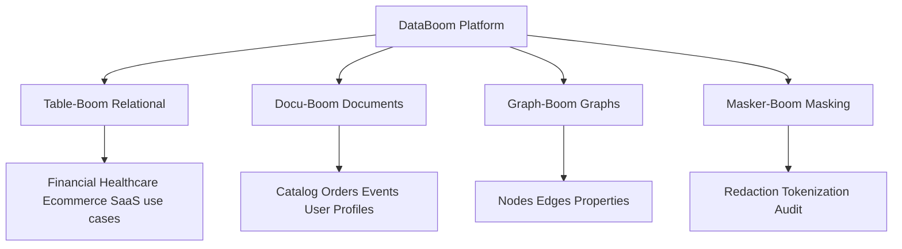
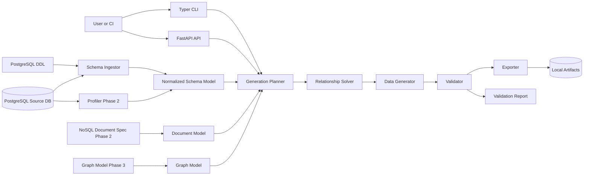
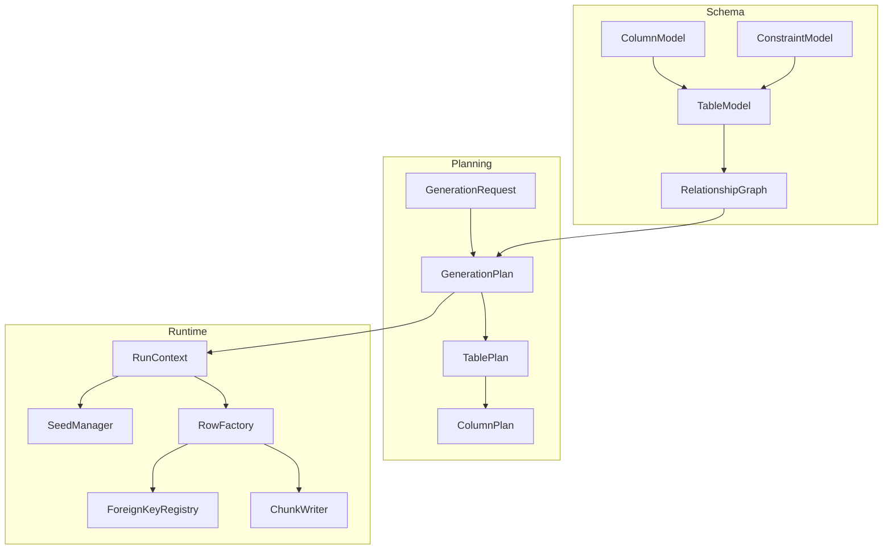
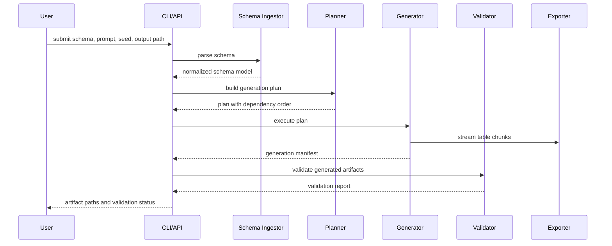

# Technical Design and Roadmap

For system-level diagrams, API flow, frontend route architecture, deployment topology, and engine extensibility, see [Architecture](architecture.md).

## Stack

- Language: Python 3.12.
- API: FastAPI.
- CLI: Typer.
- Data validation/configuration: Pydantic.
- Database access: SQLAlchemy and psycopg.
- First relational database: PostgreSQL.
- Phase 2 data family: NoSQL document data, starting with JSON/NDJSON and MongoDB-style nested records.
- Phase 3 data family: graph data with nodes, edges, labels, properties, and graph exports.
- Synthetic values: Faker plus custom generators.
- Tests: pytest.
- Deployment: Docker and Docker Compose.
- Artifact storage for Phase 1 and Phase 2: local disk.

## Product Architecture

Table-Boom, Docu-Boom, and Graph-Boom create synthetic data for different data surfaces. Masker-Boom transforms sensitive existing data while preserving useful integrity. The codebase keeps shared contracts in neutral package names such as `databoom.schema`, `databoom.generation`, `databoom.document`, and future `databoom.masking` modules.

## High-Level Design

## Low-Level Design

## Generation Sequence

## API State Persistence

The API uses a `StateStore` boundary for demo sessions, product subscriptions, and generation-run metadata. Local tests can use the in-process memory store, while Dockerized API runs use the SQLAlchemy-backed store against PostgreSQL.

This keeps route behavior independent from the storage implementation. It also lets the dashboard survive API container restarts without changing the frontend contract. Generated datasets remain on local disk in Phase 1 and Phase 2; the database stores the metadata needed to find, preview, and download those artifacts.

## Core Components

- `schema_ingestor`: parses DDL and reads PostgreSQL metadata.
- `schema_model`: stores normalized tables, columns, constraints, and relationships.
- `relationship_solver`: computes dependency order and foreign-key mappings.
- `document_model`: Phase 2 contract for NoSQL collections, nested fields, arrays, identifiers, and references.
- `graph_model`: future Phase 3 contract for node labels, edge types, properties, and graph cardinality.
- `prompt_planner`: converts prompt intent into a structured generation plan.
- `domain_profiles`: provides optional semantic value generation for use cases such as financial and healthcare demos.
- `masking_policy`: future Masker-Boom contract for classification, redaction, hashing, tokenization, and synthetic replacement.
- `generator`: streams generated rows table by table.
- `validator`: checks generated data against schema and plan.
- `exporter`: writes CSV, SQL, manifests, and reports.
- `api`: exposes auth, products, subscriptions, run creation, status, artifact, preview, and health endpoints.
- `state_store`: persists demo sessions, subscriptions, and generation-run metadata behind a replaceable API boundary.
- `cli`: supports local and CI workflows.

## Phase 1: Table-Boom Relational Foundation

Goal: build the deterministic Table-Boom backend engine for PostgreSQL schema-driven generation.

Technical objectives:

- Scaffold Python project structure.
- Implement DDL schema ingestion for common PostgreSQL tables.
- Define Pydantic schema models.
- Build relationship graph and dependency ordering.
- Implement deterministic seed handling.
- Implement local generation plans from simple prompt/row-count inputs.
- Generate primitive values for common PostgreSQL types.
- Support extensible domain profiles for financial and healthcare demo use cases.
- Preserve primary keys and foreign keys.
- Stream CSV, JSON, and SQL output to local disk.
- Produce validation reports.
- Target 100k generated records with streaming-friendly memory behavior.

Recommended commits:

1. `backend: scaffold python package and settings`
2. `backend: add schema model contracts`
3. `backend: parse postgres ddl tables and columns`
4. `backend: parse primary and foreign key constraints`
5. `backend: build relationship graph ordering`
6. `backend: add deterministic seed manager`
7. `backend: generate primitive column values`
8. `backend: preserve foreign keys during generation`
9. `backend: stream csv and sql artifacts`
10. `backend: add validation report generation`
11. `cli: add generate command`
12. `test: cover schema parsing and dependency ordering`
13. `performance: benchmark 100k record generation`
14. `docs: document phase 1 usage`

## Phase 1 Backend Implementation Steps

These steps are the concrete order for backend work before frontend or advanced LLM planning.

### Step 1: Project Foundation

- Create Python package layout.
- Add dependency management.
- Add settings model.
- Add test runner.
- Add basic logging.
- Add local artifact directory convention.

Why first: every later backend module needs a stable project structure, configuration, and test command.

### Step 2: Schema Model

- Define `DatabaseSchema`.
- Define `TableSchema`.
- Define `ColumnSchema`.
- Define `PrimaryKeyConstraint`.
- Define `ForeignKeyConstraint`.
- Define `UniqueConstraint`.
- Define normalized PostgreSQL type metadata.

Why second: generation should operate on our normalized model, not raw SQL strings.

### Step 3: DDL Schema Ingestion

- Parse `CREATE TABLE`.
- Parse columns and types.
- Parse nullable fields.
- Parse primary keys.
- Parse foreign keys.
- Parse simple unique constraints.
- Return the normalized schema model.

Why third: Phase 1 needs file-based schema intake before live database profiling.

### Step 4: Relationship Graph

- Build table nodes.
- Build foreign-key edges.
- Compute dependency order.
- Detect cycles and unsupported relationships.
- Explain graph errors clearly.

Why fourth: relational generation depends on parent tables being generated before child tables.

### Step 5: Generation Plan

- Accept row-count targets.
- Assign per-table counts.
- Attach column generation strategies.
- Attach foreign-key source rules.
- Include seed and output formats.

Why fifth: a plan makes generation reviewable, testable, and later replaceable by LLM-assisted planning.

### Step 6: Deterministic Seed Manager

- Create stable random streams per run.
- Create stable random streams per table.
- Create stable random streams per column where needed.

Why sixth: deterministic output is required for CI and reproducible debugging.

### Step 7: Row Generation

- Generate primary keys.
- Generate primitive values.
- Generate nullable values.
- Generate enum-like values.
- Generate foreign-key values from already-generated parent keys.

Why seventh: row generation can only be safe after schema, graph, plan, and seeds are defined.

### Step 8: Streaming Export

- Stream CSV output per table.
- Stream SQL inserts per table.
- Write artifact manifests.
- Avoid keeping all rows in memory.

Why eighth: large datasets require a pipeline design from the beginning.

### Step 9: Validation

- Validate row counts.
- Validate required fields.
- Validate primary-key uniqueness.
- Validate foreign-key references.
- Validate export file presence and manifest consistency.

Why ninth: generation without validation is not trustworthy.

### Step 10: CLI

- Add `databoom generate`.
- Accept schema path, prompt, seed, output path, and row targets.
- Print artifact paths and validation summary.
- Exit non-zero on validation failure.

Why tenth: the CLI is the fastest way to use the backend locally and in CI.

### Step 11: Benchmarks

- Add a 100k-record benchmark schema.
- Measure elapsed time.
- Measure peak memory if practical.
- Measure output size.
- Measure validation time.

Why eleventh: performance goals must be measured, not assumed.

## Phase 2: Table-Boom Scale, API, Profiling, and Docu-Boom

Goal: harden Table-Boom for larger local runs, expose API/CLI workflows, and add Docu-Boom for the first NoSQL/document data generation path.

Current status: Phase 2 is complete for the local full-stack product workflow. Table-Boom and Docu-Boom can be selected through the catalog, subscribed to, generated through the API, previewed in the frontend, and downloaded from local artifacts. Workspace sources are backend-owned, persisted in API state, testable from the dashboard, refreshable from live PostgreSQL introspection, and profileable for row counts, null rates, distinct counts, ranges, top values, and relationship fanout histograms. Refreshed relational sources store both resource-level metadata and a PostgreSQL DDL snapshot, so generation can run from the source contract instead of a hardcoded demo schema. Cached source profiles can now drive relationship fanout for Table-Boom runs. A 500k benchmark baseline exists, one-million-row simple and composite-key benchmark harnesses exist, validation is chunk-aware for CSV artifacts, and dashboard-triggered product runs execute asynchronously with row-level progress, ETA, throughput, and operation timings. Source-secret management, distributed worker orchestration, production retention, privacy controls, and deployment-grade observability move to later production phases instead of blocking Phase 2.

Technical objectives:

- Improve generation toward 500k records.
- Add chunked writers and artifact manifests.
- Add live PostgreSQL metadata introspection.
- Persist workspace sources and refresh relational table metadata from PostgreSQL introspection.
- Add structural profiling for row counts, null rates, cardinality, ranges, and categorical hints.
- Add FastAPI run endpoints.
- Add asynchronous product-run lifecycle with polling-friendly status responses.
- Track generated rows, current resource, rows per second, and remaining time for running jobs.
- Report operation timings for parsing, planning, exporting, validation, and total runtime.
- Add FastAPI artifact listing and download endpoints.
- Add API-key authentication.
- Persist API sessions, product subscriptions, and generation-run metadata in PostgreSQL for Dockerized runs.
- Add CLI plan and validate commands for reviewable local workflows.
- Add Docker Compose for API plus PostgreSQL.
- Keep artifacts on local disk.
- Introduce optional local prompt-plan DSL.
- Prepare LLM planner interface without requiring LLM usage.
- Add a document data model for NoSQL collections, nested fields, arrays, object IDs, and optional references.
- Export NoSQL-oriented JSON and NDJSON artifacts.
- Validate document shape, configured counts, required fields, and reference consistency where references exist.
- Keep Masker-Boom in design only until Phase 4.

Implemented MVP capabilities:

- Product catalog with `kind` values for relational, document, graph, and masking products.
- Table-Boom relational generation through product-run APIs.
- Docu-Boom NoSQL document generation with nested objects, arrays, references, JSON, and NDJSON artifacts.
- Document preview endpoint for top documents per collection.
- SQL-backed demo auth, subscriptions, and run metadata in Dockerized API runs.
- Backend-owned workspace source store seeded with demo sources and refreshable from PostgreSQL metadata.
- Generic frontend workspace that renders relational tables or MongoDB-style documents based on product kind.
- Async product-run endpoint with in-process background execution, generated row counters, progress percentage, rows per second, expected seconds, remaining seconds, and operation timings.
- Frontend polling that shows live run status, row progress, throughput, and attempts top-20 table/document previews during generation.
- Dashboard source controls for PostgreSQL connection testing, source creation, schema refresh, and profiling.
- Rich refreshed source metadata: schema name, column details, primary keys, foreign keys, unique constraints, DDL snapshot, and refresh timestamp.
- Product run requests can pass a persisted `source_id`, so Table-Boom generation can use refreshed workspace schema contracts.
- Run builder UI shows selected source context, schema freshness, profiling state, generation progress, validation, and operation timing stages.
- 500k relational benchmark baseline with export, validation, memory, and artifact-size metrics.
- One-million-row simple-key and composite-key relational benchmark harnesses.
- Chunk-aware CSV validation that avoids holding every generated row in memory.

Recommended commits:

1. `performance: stream generation in configurable chunks`
2. `backend: add live postgres schema introspection`
3. `backend: profile structural table statistics`
4. `api: add generation run endpoints`
5. `api: add artifact download endpoints`
6. `security: add api key authentication`
7. `cli: add plan and validate commands`
8. `infra: add docker compose api and postgres`
9. `optimization: reduce memory use for large exports`
10. `performance: benchmark 500k record generation`
11. `backend: add nosql document model`
12. `backend: generate nested document artifacts`
13. `backend: validate nosql document artifacts`
14. `docs: document api cli and nosql workflows`

## Phase 3: LLM Planning, Graph-Boom, and Operator Experience

Goal: add LLM-assisted planning behind a safe, replaceable interface, add Graph-Boom data generation, and create richer operator-facing experiences.

Technical objectives:

- Add prompt pack loading.
- Add prompt cache key strategy.
- Add planner output schema validation.
- Add benchmark prompts and golden plan tests.
- Support dry-run plan review.
- Add a lightweight frontend or dashboard only if it improves run visibility.
- Show run status, artifacts, validation errors, and plan review.
- Keep local deterministic planner as fallback.
- Add a graph data model for nodes, edges, labels, properties, and cardinality.
- Generate graph node and edge artifacts.
- Validate edge references, node counts, edge counts, and property shapes.
- Add graph preview and graph plan review concepts to the frontend.

Recommended commits:

1. `backend: add planner interface abstraction`
2. `backend: load versioned prompt packs`
3. `backend: validate llm planner output schema`
4. `optimization: add prompt cache key generation`
5. `test: add golden planner prompt cases`
6. `api: expose dry run plan review`
7. `backend: add graph data model`
8. `backend: generate graph node and edge artifacts`
9. `backend: validate graph data artifacts`
10. `frontend: build generation run dashboard`
11. `frontend: add plan and graph review views`
12. `docs: document prompt pack and graph model maintenance`

## Phase 4: Masker-Boom Privacy, Policies, and Security Hardening

Goal: add Masker-Boom as the privacy and masking service layer for sensitive environments.

Technical objectives:

- Add policy file format.
- Add sensitive field detection hints.
- Add synthetic replacement, hashing, tokenization, redaction, and allowlist reuse.
- Preserve primary-key and foreign-key integrity during masking.
- Preserve useful formats, null rates, and distributions where policy allows.
- Prevent raw sampled values from being logged.
- Add privacy validation report.
- Add audit logs for runs.
- Add secret handling guidance.
- Add stronger production deployment controls.

Recommended commits:

1. `backend: add masker-boom policy model`
2. `backend: detect likely sensitive fields`
3. `backend: add stable tokenization policy`
4. `backend: add redaction and synthetic replacement policies`
5. `backend: preserve masked relationship integrity`
6. `backend: validate privacy policy compliance`
7. `security: remove raw values from profiler logs`
8. `api: expose privacy policy configuration`
9. `test: cover policy engine edge cases`
10. `docs: document masker-boom policy format`

## Phase 5: Production Release and Extensibility

Goal: make the DataBoom platform production-grade for Table-Boom, Docu-Boom, Graph-Boom, Masker-Boom, deployment, operations, and future adapters.

Technical objectives:

- Add production Dockerfile.
- Add CI for linting, tests, type checks, and build verification.
- Add health and readiness endpoints.
- Add structured JSON logs with run IDs.
- Add configurable artifact retention.
- Add deployment documentation.
- Add adapter boundaries for future MySQL, SQLite, SQL Server, BigQuery, NoSQL stores, graph stores, and object storage.
- Add release process and versioning.

Recommended commits:

1. `infra: add production dockerfile`
2. `infra: add ci test and build workflow`
3. `api: add health and readiness endpoints`
4. `backend: add structured run logging`
5. `backend: add artifact retention configuration`
6. `cleanup: stabilize public interfaces`
7. `docs: add deployment guide`
8. `release: prepare v0.1.0`

## Deployment Objectives

Production deployment should include:

- Dockerfile.
- Docker Compose for local deployment.
- environment-based configuration,
- API-key authentication,
- health endpoint,
- readiness endpoint,
- structured JSON logs,
- request and run IDs,
- local artifact storage in early phases,
- configurable artifact storage later,
- database connection timeout and retry controls,
- CI build and test verification.

## Performance Targets

- Phase 1: generate 100k total records across related tables.
- Phase 2: generate 500k total records across related tables.
- Phase 2: add validated NoSQL document generation with JSON/NDJSON artifacts.
- Phase 3: add validated graph data generation with node and edge artifacts.
- Generation should stream rows and avoid holding full datasets in memory.
- Validation should be chunk-aware where possible.
- Performance benchmarks must report record count, table count, elapsed time, peak memory, output size, and validation time.
