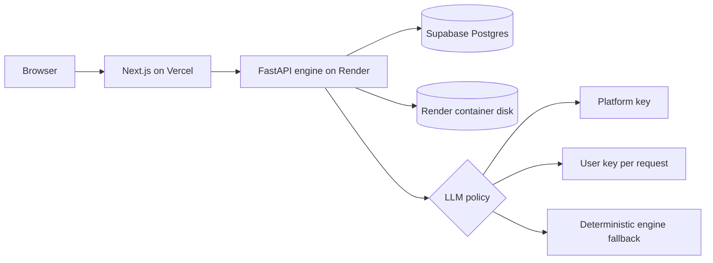

# Deployment Guide: Render + Supabase + Vercel

This guide describes the current deployable DataBoom stack.



## What Runs Where

| Layer | Service | Responsibility |
| --- | --- | --- |
| Frontend | Vercel | Public site, login/register, dashboard, settings, previews, downloads. |
| Backend | Render | FastAPI API, generation engine, async run manager, artifact serving. |
| State | Supabase Postgres | Users, sessions, subscriptions, workspace sources, profiles, run metadata. |
| Artifacts | Render container disk | Generated CSV, JSON, NDJSON, SQL, manifest, validation files. |
| LLM | Optional external provider | Structured plan proposals only; deterministic planning and generation remain available. |

## Supabase Setup

1. Create a Supabase project.
2. Open the database connection settings.
3. Copy a Postgres connection string.
4. Use it as `DATABOOM_DATABASE_URL` in Render.

The backend normalizes `postgres://` and `postgresql://` URLs to `postgresql+psycopg://` because the Python runtime installs the psycopg driver.

For pooled Supabase URLs, the SQLAlchemy state store disables psycopg automatic prepared statements with `prepare_threshold=None`. This matters because Supabase transaction pooling does not support prepared statements.

## Render API Setup

Use the root `render.yaml` Blueprint or create one Docker web service manually.

Required Render variables:

```text
DATABOOM_ENV=production
DATABOOM_ARTIFACT_ROOT=/app/artifacts
DATABOOM_DATABASE_URL=<supabase connection string>
DATABOOM_CORS_ORIGINS=https://<your-vercel-app>.vercel.app,http://localhost:3000
DATABOOM_ALLOW_REGISTRATION=true
```

Optional Render variables:

```text
DATABOOM_SEED_EMAIL=<reviewer email>
DATABOOM_SEED_NAME=<reviewer display name>
DATABOOM_SEED_PASSWORD=<reviewer password>
DATABOOM_LLM_PLATFORM_API_KEY=<admin/provider key>
DATABOOM_LLM_DEFAULT_MODEL=gpt-4.1-mini
DATABOOM_LLM_REQUEST_TOKEN_LIMIT=4000
DATABOOM_LLM_TIMEOUT_SECONDS=20
DATABOOM_LLM_MAX_RETRIES=1
```

The Render health check path is `/ready`.

Artifact note: the current deployment writes generated files to Render container disk. That is acceptable for the current MVP and reviewer sessions. A durable production deployment should move artifacts to object storage or attach a persistent Render Disk.

## Vercel Frontend Setup

Create a Vercel project with:

```text
Root directory: frontend
Install command: npm ci
Build command: npm run build
Output: Next.js default
```

Required Vercel variables:

```text
NEXT_PUBLIC_DATABOOM_API_URL=https://<your-render-api>.onrender.com
```

Optional Vercel variables:

```text
NEXT_PUBLIC_SUPABASE_URL=<supabase project url>
NEXT_PUBLIC_SUPABASE_ANON_KEY=<supabase anon key>
```

The Supabase public values are reserved for future direct Supabase Auth/client features. The current frontend authenticates through the FastAPI backend.

## LLM Key Policy

DataBoom must keep running even when provider credits are exhausted. The policy order is:

1. Use a user-supplied API key for the current request when provided from Settings.
2. Use the platform/admin key when configured on Render.
3. Fall back to deterministic non-LLM generation.

Current behavior:

- `/settings` can show whether the platform key is configured.
- `/settings` can hold a user key for planning requests in the current browser tab.
- The user key uses tab-scoped `sessionStorage`; it is not persisted in backend state or plan metadata.
- A hosted model proposes a validated plan but does not generate bulk records.
- Users review and approve a plan before the async engine can execute it.
- Provider failures return a deterministic plan with a safe fallback reason.
- The generation engine remains deterministic and available without any LLM key.

## Smoke Test

1. Open the Vercel URL.
2. Register a new account or sign in with the configured seed email.
3. Open `/settings` and confirm the LLM provider mode.
4. Open `/settings/subscriptions` and subscribe to an active product.
5. Open `/dashboard`, choose a source/resource, create and approve a small plan, and inspect preview output.
6. Open `/runs` and confirm the generated run and artifacts are visible.

## Current Production Gaps

- Async runs are still managed in-process by the FastAPI instance.
- Artifact files are local to the API container unless a persistent disk or object storage is added.
- Registration is open when `DATABOOM_ALLOW_REGISTRATION=true`; close it for private deployments after reviewer accounts are created.
- Supabase Auth is planned, but current auth is backend-owned email/password with hashed passwords.

## References

- Render Blueprints: https://render.com/docs/infrastructure-as-code
- Render Blueprint YAML: https://render.com/docs/blueprint-spec
- Supabase Postgres connection strings and pooling: https://supabase.com/docs/guides/database/connecting-to-postgres
- Vercel environment variables: https://vercel.com/docs/environment-variables
- Next.js environment variables: https://nextjs.org/docs/app/guides/environment-variables
