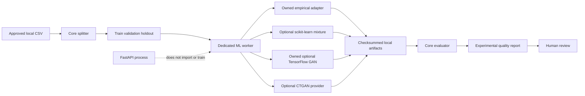

## Context

DataBoom currently has a deterministic, profile-guided generator and documented
Q0-Q5 quality policy, but no executable source-trained model boundary. The first
neural slice crosses data splitting, training dependencies, model artifacts,
quality/privacy evidence, and operational isolation. It therefore cannot be a
single adapter class hidden inside an API route.

The web application must remain lightweight and reliable when NumPy, pandas,
scikit-learn, TensorFlow, PyTorch, or a GAN provider is absent. Source data and
model files are more sensitive than ordinary generated demo artifacts, and a
Python model pickle is executable input rather than a passive data file. The
maintained standalone `ctgan` package is also BUSL-1.1 and pre-alpha at the
researched 0.12.1 release, so its use must be optional and visible in lineage.

## Goals / Non-Goals

**Goals:**

- Establish stable contracts for source-trained tabular experiments.
- Produce deterministic, leak-resistant split manifests without loading the
  complete CSV dataset in memory.
- Compare an owned empirical baseline, an optional scikit-learn mixture model,
  an owned TensorFlow GAN, and optional CTGAN through one interface.
- Record enough lineage to reproduce or audit a local experiment.
- Report fidelity, diversity, exact-copy exposure, performance, and incomplete
  evidence as separate dimensions.
- Keep training and model loading in a dedicated CLI worker process.

**Non-Goals:**

- Public training endpoints, frontend controls, distributed scheduling, or GPU
  orchestration.
- Automatic production release of a trained model.
- Formal privacy, multi-table synthesis, hyperparameter search, or a universal
  quality score.
- Treating third-party pickle files as safe input.

## Decisions

### 1. Use file-backed experiment contracts

The worker accepts local CSV paths and writes split CSVs, JSON manifests, model
artifacts, samples, and quality reports beneath one explicit experiment root.
Contracts store relative artifact names plus checksums and row counts. The
FastAPI state store is not expanded in this change.

Alternative: pass pandas dataframes through the API. Rejected because it couples
the web process to the ML stack, encourages large in-memory requests, and blurs
source-data trust boundaries.

### 2. Split by stable hashes, with optional subject grouping

The splitter hashes a seed plus either the row index or normalized group-column
values into train, validation, and holdout ranges. All rows for one group receive
the same assignment. The service streams the input twice: once to validate and
fingerprint it, once to write partitions and their checksums.

Alternative: shuffle all row indexes in memory. Rejected because memory grows
with the dataset and grouping still requires extra bookkeeping.

### 3. Keep the adapter protocol web-safe and dependencies lazy

`databoom.synthesis` contracts and registry use the standard library and
Pydantic only. Provider adapters import NumPy, scikit-learn, TensorFlow, pandas,
torch, and `ctgan` only inside worker methods. The FastAPI module graph never
imports a provider runtime.

An owned independent empirical adapter is always available and establishes the
minimum source-trained baseline. A scikit-learn Gaussian-mixture adapter adds a
classical joint-model baseline. An owned TensorFlow adapter establishes a
replaceable native GAN path without inheriting CTGAN's provider license. CTGAN
remains a research-backed mixed-tabular benchmark. Every provider is selected by
capability rather than product name.

Alternative: depend on the full SDV library in the base application. Rejected
because it expands startup size and licensing surface and makes API health
dependent on a training stack.

### 4. Give classical ML and the owned GAN explicit roles

The scikit-learn candidate fits a Gaussian mixture to a reversible mixed-type
encoding and stores numeric model parameters as JSON. It is more expressive than
independent marginals and cheaper to train and inspect than a neural candidate.

The TensorFlow candidate trains an owned bounded tabular GAN on the same encoding
and stores the generator in the Keras v3 format. It exists to make DataBoom's
neural architecture owned and extensible, not to claim that a generic GAN beats
CTGAN. Both are optional worker extras and must compete through holdout evidence.

Alternative: include TensorFlow in the base API dependency set. Rejected because
the CPU wheel is large and model training has a different reliability and
security boundary from request serving.

### 5. Normalize missing values at the provider boundary

The CTGAN adapter maps discrete nulls to a reserved category. For each nullable
continuous column it adds a discrete null-indicator column and median-imputes the
training value, then restores nulls and removes the helper column after sampling.
The transformation is stored in lineage so the original CSV shape is restored.

Alternative: reject every CSV containing nulls. Rejected because missingness is
fundamental to tabular data, although conditional missingness fidelity remains a
later quality metric.

### 6. Treat model artifacts according to their serialization risk

Every model artifact has a SHA-256 checksum in a JSON manifest. The empirical
and scikit-learn adapters use data-only JSON. The TensorFlow adapter uses the
Keras v3 format without custom objects and loads it in safe mode. A CTGAN pickle
may be loaded only from the explicit experiment directory and only after its
checksum matches. The CLI does not accept arbitrary remote model URLs. This
guards accidental corruption but is not a signature or sandbox.

Alternative: claim checksum verification makes pickle safe. Rejected; an
attacker who can replace both files can still execute code. Signed manifests and
a hardened worker/container are follow-on security work.

### 7. Produce an experimental recommendation, not production promotion

Each candidate is sampled with the same requested row count and evaluation seed.
The evaluator reports structural validity, numeric KS and normalized mean error,
categorical total-variation distance, synthetic uniqueness, exact training-row
matches, fit/sample time, and reproducibility observations.

A candidate can be recommended only when every configured hard gate passes.
The decision remains `experimental` because membership inference, attribute
inference, downstream utility, signed lineage, and isolated production workers
are not complete. The report cannot use `anonymous` or `privacy-safe` wording.

Alternative: rank by one weighted score. Rejected because an average can hide a
privacy or structural failure.

## Trust Boundaries and Failure Modes

- Missing optional dependencies -> the adapter is reported unavailable; the
  core application and empirical candidate remain usable.
- Invalid ratios, duplicate columns, too few split units, empty partitions, or
  group overlap -> fail before training.
- NaN/infinite numeric source values -> normalize supported missing values and
  reject non-finite non-missing values.
- Provider fit/sample error -> persist a failed candidate result without hiding
  other candidate evidence.
- Artifact checksum mismatch or path escape -> refuse model loading.
- Quality or exact-copy gate failure -> candidate is not recommended.

## Migration Plan

1. Land contracts, splitter, evaluator, baseline, and tests without changing API
   behavior.
2. Add optional scikit-learn, TensorFlow CPU, and CTGAN extras and lazy adapters;
   keep the base installation clean.
3. Add the worker CLI and run a controlled fixture experiment when the optional
   environment is installed.
4. Update documentation and archive this completed OpenSpec change.
5. A later OpenSpec change may add isolated job workers and API orchestration
   after security and licensing review.

Rollback removes the optional worker command and `databoom.synthesis` package;
existing Table-Boom, Docu-Boom, Graph-Boom, API, and artifact contracts remain
unchanged.

## Open Questions

- Whether DataBoom will ship a BUSL CTGAN provider in commercial distributions
  or replace it with an internally owned PyTorch implementation requires product
  and legal review.
- GPU worker images, signed model manifests, durable model storage, and formal
  privacy policy thresholds are intentionally deferred.
