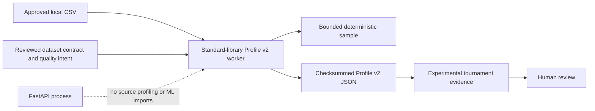

## Context

DataBoom already stores a lightweight PostgreSQL workspace profile and the first
source-trained tournament computes direct holdout metrics. Those shapes are useful
for generation hints and one evaluation run, but they are not a versioned evidence
contract for model comparison. Profile v2 must be reusable by later statistical
adapters while remaining deterministic, bounded in memory, and safe to import in
the web process.

## Goals / Non-Goals

**Goals:**

- Define immutable, provider-neutral profile and quality-intent contracts.
- Produce stable profile identifiers from the source fingerprint, contract, and
  profiling configuration.
- Keep memory bounded by a configured sample limit while preserving exact row and
  missingness counts.
- Cover univariate distributions, missingness, and pairwise dependency summaries.
- Add checksummed profile lineage to experiments without changing release policy.

**Non-Goals:**

- Exact full-table quantiles or high-cardinality frequency maps for local CSVs.
- Privacy attacks, formal differential privacy, or automatic model promotion.
- Relational, temporal, or graph-native profile contracts.
- Training-library imports, public API orchestration, or distributed workers.

## Decisions

### 1. Keep Profile v2 inside the web-safe synthesis contract boundary

Profile models use Pydantic and standard-library scalar types only. The local CSV
implementation uses `csv`, `hashlib`, `heapq`, and `math`; it does not depend on a
model provider. This lets later adapters consume the same artifact without making
FastAPI startup depend on a data-science stack.

### 2. Combine exact streaming counters with a deterministic bounded sample

One pass computes the source checksum, row count, and exact per-column null counts.
At the same time, the profiler retains only the configured number of rows with the
smallest stable SHA-256 priorities derived from the seed, row index, and canonical
row values. Complex distribution and dependency summaries are computed from that
sample and are labeled as sampled evidence.

Alternative: retain every row or exact category map. Rejected because memory would
grow with source size and violate the local worker boundary.

### 3. Use explicit typed summaries instead of one profile dictionary

Continuous columns record observed/sample counts, finite min/max, mean, standard
deviation, skew, configured quantiles, equal-width histograms, and Tukey lower and
upper tail rates. Discrete columns record sampled distinct count, bounded top
values, other count, and coverage. Every column retains exact null count/rate.

Pairwise summaries use Pearson correlation for continuous pairs, Cramer's V for
discrete pairs, and correlation ratio for mixed pairs. Missingness association is
reported separately when both missingness indicators vary. Undefined statistics
are omitted with warnings rather than converted to misleading zeroes.

### 4. Make quality intent declarative and non-promotional

`DataQualityIntent` declares required evidence dimensions, weighted or protected
columns, quantile points, histogram size, and sample bound. It validates referenced
columns against the reviewed dataset contract. It does not contain calibrated
release thresholds; the existing evaluation policy remains experimental.

### 5. Persist profile paths and checksums as experiment lineage

The standalone profile command writes one canonical JSON artifact and a small
manifest containing the relative path and SHA-256. Tournament execution writes
training and holdout profiles once and one synthetic profile per completed
candidate. Reports reference those relative artifacts. Direct metric gates remain
authoritative until profile-based thresholds are separately calibrated.

## Trust Boundaries and Failure Modes

- Missing/duplicate CSV columns or malformed row widths -> reject before writing a
  completed artifact.
- Non-finite continuous values -> treat empty values as missing and reject other
  non-finite values with the column and row identified.
- Empty source or no observed values for a column -> retain exact counts and emit
  explicit warnings; never fabricate distribution values.
- Profile path escape or checksum mismatch -> reject before consuming lineage.
- Sample limit below the minimum or unsupported quantiles -> contract validation
  fails before scanning the source.
- Candidate profile failure -> record that candidate as failed without discarding
  previously completed candidate evidence.

## Migration Plan

1. Land contracts and standalone profiling with controlled fixtures.
2. Add the CLI and artifact integrity verification.
3. Attach training, holdout, and synthetic profile paths to tournament reports.
4. Update documentation, complete tasks, archive the change, and validate specs.

Rollback removes the new command and optional report fields. Existing split,
adapter, and direct evaluation contracts remain readable.

## Open Questions

- Public-dataset calibration may change default sample bounds and histogram sizes,
  but those values must be versioned rather than silently replaced.
- PostgreSQL-native Profile v2 aggregation can later implement the same contract
  with database-side quantiles; this change establishes the portable CSV baseline.
